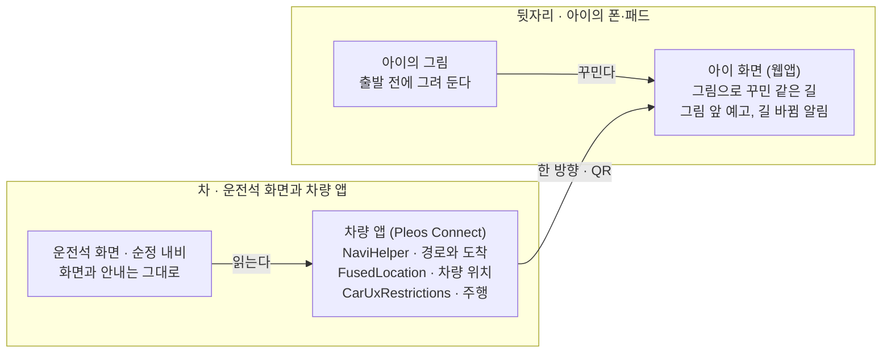

# HI-MAP — 설계

운전석 내비는 그대로 두고, 뒷자리 아이의 폰·패드에 아이가 직접 그린 그림으로 꾸민 "아이의 내비"를 띄웁니다. 운전자만 보던 길을 탄 사람 모두가 함께 봅니다.

이 문서는 두 화면으로 나눈 설계를 적습니다. 지금 저장소에 무엇이 만들어져 있고 무엇이 남았는지는 [SDK.md](SDK.md)의 "구현 상태"에 있습니다.

## 구성

아이 화면은 차가 보낸 길과 아이가 그린 그림으로 만들어집니다.

| 구분 | 차량 앱 | 아이 화면 |
|---|---|---|
| 도는 곳 | Pleos Connect(차량 인포테인먼트) | 아이의 폰·패드 브라우저. 설치 없음 |
| 하는 일 | 순정 내비의 경로 시작·변경·도착, 차량 위치, 주행·정차 상태를 읽어 아이 기기로 보냄 | 그리기, 지도 꾸미기, 여정 미리 보기, 주행 중 그림 지도와 예고 |
| 화면 | 정차 중의 연결 QR, 작은 연결 표시 | 그림 지도, 여정 띠, 다음 그림 카드 |
| 소리 | 없음. 순정 내비 안내 그대로 | 예고 음성. 아이 기기에서만 남 |
| 저장 | 저장하지 않고 전달만 함 | 그림과 꾸민 지도를 아이 기기 안에 저장 |

두 화면의 연결(QR로 짝 맺기, 위치·경로 전송)은 아직 만들지 않았습니다.

## 아이 화면의 기능

| 기능 | 언제 | 내용 |
|---|---|---|
| 내 그림 그리기 | 출발 전, 집이나 주차장 | 손가락으로 그려 저장합니다. 형광펜·사인펜·네임펜·붓, 굵기 30단계, 색 만들기(RGB), 스포이트. 그리기 어려운 아이는 예시 그림을 고릅니다(사진 고르기는 다음 단계) |
| 지도 꾸미기 | 출발 전 | 내 장소(집·학교)와 길가 랜드마크를 그림 아이콘으로, 건물·공원·물을 칠한 무늬로 바꿉니다. 도로·경로선·진행 방향은 고정입니다 |
| 목소리 고르기 | 출발 전 | 예고를 읽어 줄 목소리를 넷 가운데 고릅니다(새로 만든 캐릭터 솔이·보리·단비·별이) |
| 여정 미리 보기 | 출발 전 | 집에서 목적지까지 그림을 순서대로 보여 줍니다. "그림 3개를 지나면 학교예요." |
| 아이의 내비 | 주행 중 | 운전석 내비와 같은 길 위에서 내 차가 움직입니다. 아래 여정 띠에 지나온 그림과 남은 그림이 보입니다 |
| 그림 앞 예고 | 그림 바로 앞 | "곧 빨간 편의점이 나와요." 늘 같은 틀의 문장입니다 |
| 길 바뀜 알림 | 순정 내비가 경로를 바꾼 직후 | "길이 바뀌었어요."를 먼저 말하고 지도를 다시 그립니다. 지나온 그림은 남기고, 이미 알린 그림은 다시 말하지 않습니다 |
| 지금 어디야? | 주행 중 아이가 누를 때 | "그림 2개를 지나면 학교예요." |
| 도착과 내 길 | 도착 | "학교에 도착했어요." 지나온 길을 "내 길"로 저장해 다음 날 같은 순서로 보여 줍니다("내 길" 저장은 아직 없습니다) |

알림에는 세 가지 원칙이 있습니다.

- **늘 같은 문장.** "곧 ~가 나와요.", "길이 바뀌었어요.", "~에 도착했어요." 같은 일에는 같은 말을 씁니다.
- **길이 바뀌면 먼저 말한다.** 지도를 다시 그리기 전에 "길이 바뀌었어요."를 먼저 말합니다.
- **알릴 수 없는 것은 약속하지 않는다.** 길이 바뀐 직후 너무 가까워 미리 알릴 수 없는 장소는 그림 자리로 세지 않습니다.

## 기존 기능·서비스와 다른 점

가는 길은 순정 내비와 같고, 보는 사람과 보여 주는 방식이 다릅니다.

| 구분 | 누구를 위해 | 무엇을 보여 주나 | HI-MAP과의 차이 |
|---|---|---|---|
| 순정 내비(운전석 화면) | 운전자 | 경로선, 회전 안내, 글자 | 운전을 위한 화면이라 아이가 읽기 어렵고, 카시트에서는 손이 닿지 않습니다. HI-MAP은 이 화면을 바꾸지 않고 같은 길을 아이 기기에 따로 보여 줍니다 |
| 뒷좌석 어린이 엔터테인먼트 앱 | 아이 | 게임·영상 같은 콘텐츠 | 지루함은 덜지만 가는 길을 보여 주는 것이 목적이 아닙니다. HI-MAP은 길 자체를 아이의 볼거리로 만듭니다 |
| 지도 앱의 위치·도착 시간 공유 | 차 밖에서 기다리는 사람 | 어른용 지도 위의 위치와 도착 예정 시간 | 같은 차에 탄 아이를 위한 표현이 아닙니다. HI-MAP은 아이가 그린 그림과 짧은 문장으로 알립니다 |
| HI-MAP | 탄 사람 모두 | 아이가 그린 그림으로 꾸민, 운전석 내비와 같은 길 | 운전석 화면은 그대로 두고, 길이 바뀌는 순간까지 아이에게 먼저 알립니다 |

## 차량 특화 요소

그림 지도는 폰에서도 그릴 수 있지만, 운전자가 실제로 안내받는 그 길과 맞물리는 것은 차량 앱이 있어야 됩니다.

| 필요한 것 | 폰 앱만으로는 | 차량 앱(Pleos Connect)과 이으면 |
|---|---|---|
| 운전석 내비가 안내를 시작한 길 | 알 수 없음. 아이나 보호자가 따로 입력 | NaviHelper의 `onRouteStarted`, `onRoutingCompleted` |
| 경로가 바뀌는 순간 | 알 수 없음 | NaviHelper의 `onReRouteEnded` |
| 남은 시간과 거리 | 따로 계산한 추정값 | NaviHelper의 `onTripInfo`. 순정 내비의 값 그대로 |
| 도착 | 위치로 짐작 | NaviHelper의 `onDestinationArrived` |
| 차의 위치 | 아이 기기의 GPS와 위치 권한이 필요 | FusedLocation의 차량 위치. 아이 기기는 위치 권한이 필요 없음 |
| 주행·정차 상태 | 알 수 없음 | AAOS CarUxRestrictionsManager의 주행 제한 상태 |
| 목적지 맞추기 | 아이 기기에 따로 입력 | 순정 내비의 목적지를 따름. 자주 가는 곳은 `requestRoute`로 순정 내비에 넣음 |

## 주행 안전 설계

운전자가 할 일은 정차 중의 연결 한 번뿐이고, 주행 중 운전석 화면에는 새로 뜨는 화면도 영상도 효과음도 없습니다.

| 규칙 | 구현 | 이유 |
|---|---|---|
| 운전석 화면은 바꾸지 않는다 | 순정 내비 화면과 음성 안내에 손대지 않습니다. 차량 앱의 화면은 정차 중의 연결 QR과 작은 연결 표시뿐입니다 | 운전자 주의 분산 방지. 길 안내는 순정 내비가 맡습니다 |
| 운전자의 조작은 정차 중 한 번 | 연결 QR은 주행 제한 상태(CarUxRestrictions)를 보고 정차 중에만 띄웁니다 | 운전 중 영상표시장치 조작 금지(도로교통법 제49조 제1항 제11호의2) |
| 차에서 아이 기기로, 한 방향 | 차량 앱은 보내기만 하고 아이 기기의 조작을 받지 않습니다 | 아이의 조작이 차와 운전석 화면에 영향을 주지 않게 |
| 주행 중 운전석에 새 화면·영상·효과음 없음 | 주행 중 차량 앱은 화면을 바꾸지 않고 소리를 내지 않습니다 | Pleos Connect 주행 안전 설계 기준(영상 금지, 움직이는 요소 최소화) |
| 소리는 아이 기기에서만 | 예고 음성은 아이 기기에서 납니다. 차 스피커로 읽는 보조 모드는 선택이며 순정 내비 안내가 먼저입니다 | 길 안내 음성을 가리지 않기 위함 |
| 길은 아이가 바꿀 수 없다 | 도로·경로선·진행 방향은 꾸미기에서 고정입니다 | 지도가 실제 길과 다르게 보이지 않게 |
| 늘 같은 문장 | "곧 ~가 나와요.", "길이 바뀌었어요.", "~에 도착했어요." | 같은 일에는 같은 말이어야 아이가 예측할 수 있습니다 |
| 알릴 수 없는 것은 약속하지 않는다 | 길이 바뀐 직후 너무 가까운 장소는 그림 자리로 세지 않고, 이미 지나간 그림은 말하지 않습니다 | 예고가 틀리면 믿음이 깨집니다 |
| 달리는 동안 아이 화면은 따라가는 화면 | 출발하면 편집을 닫고 보기 화면으로 바꿉니다. 깜빡임과 튀는 효과가 없습니다 | 달리는 동안에는 길을 따라가는 데 집중하도록 |
| 정보는 최소한으로 | 그림은 아이 기기에만 저장합니다. 차가 보낸 위치와 경로는 이동이 끝나면 지웁니다. 계정이 없습니다 | 아동의 위치 정보를 다루는 서비스 |
| 의료 판단을 하지 않는다 | 진단이나 치료를 하지 않고, 설정은 보호자와 아이가 정합니다 | 앱은 이동을 돕는 도구입니다 |

## 사용 시나리오

매일 아침 특수학교까지 편도 30분 넘게 운전하는 보호자와 뒷자리의 아이가, 같은 길을 각자의 화면으로 함께 갑니다.

1. **주말, 집이나 주차장에서**: 아이가 자기 패드에 "빨간 편의점"과 "파란 다리"를 그리고, 통학길의 편의점과 다리에 붙입니다.
2. **월요일 아침, 출발 전(정차)**: 보호자는 평소처럼 순정 내비에서 "학교"를 고릅니다. 차 화면에 뜬 QR을 아이 패드로 찍으면 두 화면이 이어지고, 아이 화면에 오늘 갈 길이 그려집니다.
3. **미리 보기(정차)**: 아이가 오늘 지나갈 그림을 순서대로 봅니다. "우리 집, 소방서, 파란 다리, 빨간 편의점, 학교."
4. **주행**: 운전석 화면은 평소의 내비 그대로입니다. 아이 화면에서는 내 차가 그림 지도 위를 움직이고, 편의점 앞에서 "곧 빨간 편의점이 나와요."라고 알립니다.
5. **길이 바뀔 때(주행)**: 순정 내비가 경로를 바꾸면, 아이 화면이 "길이 바뀌었어요."를 먼저 말하고 지도를 다시 그립니다. 운전자는 아무것도 하지 않아도 됩니다.
6. **도착**: "학교에 도착했어요."

| 장면 | 운전석 화면 | 차량 앱이 받는 신호 | 아이 화면 |
|---|---|---|---|
| 연결(정차) | 순정 화면과 연결 QR | CarUxRestrictions: 정차 상태 | QR을 찍어 연결. "차와 연결됨" 표시 |
| 출발 전 | 순정 내비에서 목적지 선택 | NaviHelper `onRouteStarted`, `onRoutingCompleted` | 오늘 갈 길과 그림 순서를 미리 보기 |
| 출발 | 순정 내비 안내 | CarUxRestrictions: 주행 상태, FusedLocation 위치 | 편집을 닫고 길을 따라가는 화면으로 |
| 그림 앞 | 그대로 | FusedLocation 위치로 그림까지 남은 거리 계산 | "곧 빨간 편의점이 나와요." |
| 길 바뀜 | 순정 내비가 새 경로를 안내 | NaviHelper `onReRouteEnded` | "길이 바뀌었어요." 뒤 지도를 다시 그리고 남은 그림 수를 알림 |
| 도착 | 순정 내비 도착 안내 | NaviHelper `onDestinationArrived` | "학교에 도착했어요." |

1번과 3~6번의 아이 화면은 `web-prototype/index.html`의 웹 동작 시안에서 볼 수 있습니다. 지도는 시연용 가상 동네이고, 차량 신호는 재생으로 대신했습니다.
